At the heart of this course is the belief that every child has a creative spark that is worth carefully fanning the flames. I want to help kids recognize and nurture their unique gifts, and give them the tools and support they need to bring their ideas to life. By the end of this course, kids gain valuable experience in creative expression and storytelling, and will have a deeper appreciation for the power of their own ideas.

Here are the slides for our first lesson for introduction and unleashing kids' inner creativity and imagination with the help of our friendly wizard character:

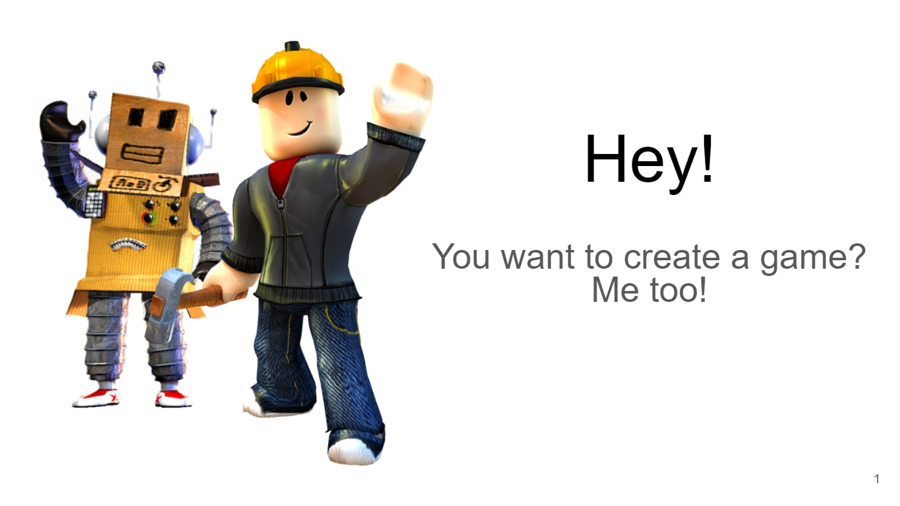{: loading="lazy"}
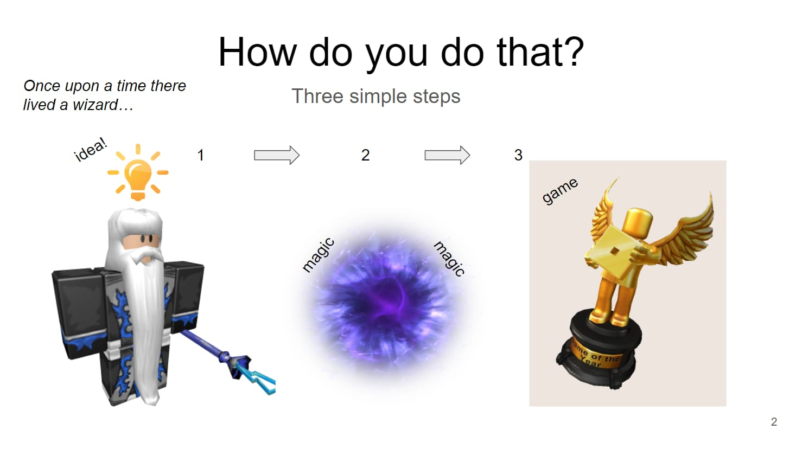{: loading="lazy"}
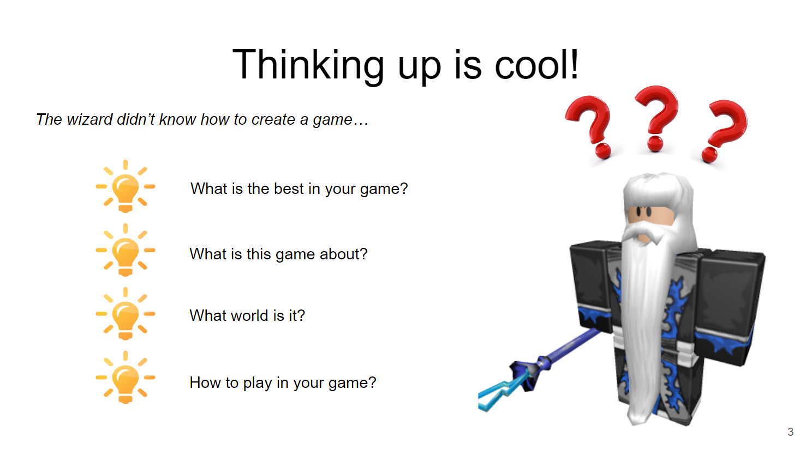{: loading="lazy"}
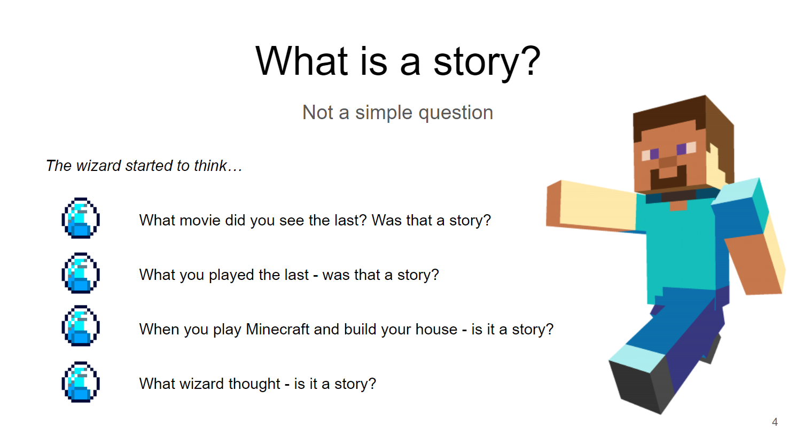{: loading="lazy"}
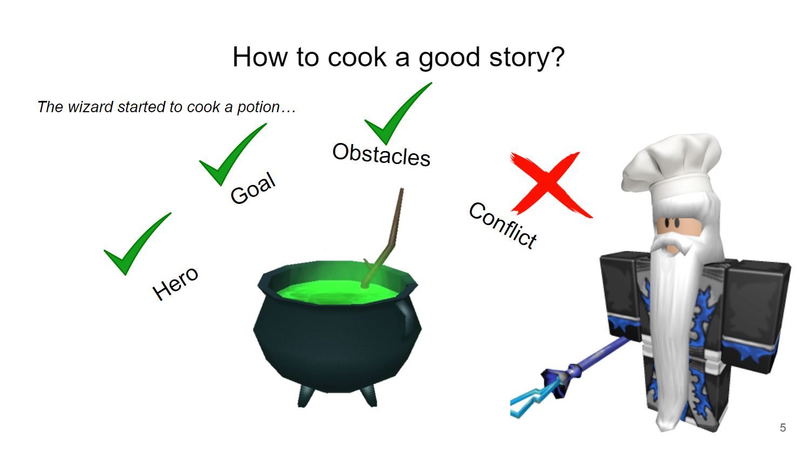{: loading="lazy"}
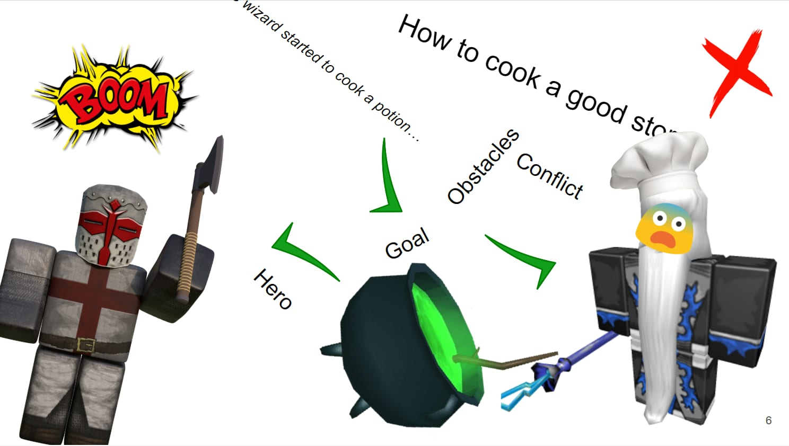{: loading="lazy"}
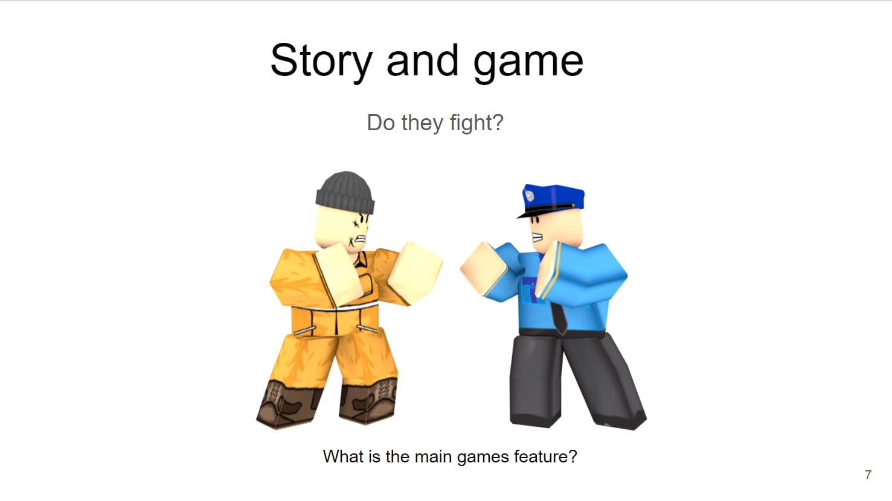{: loading="lazy"}
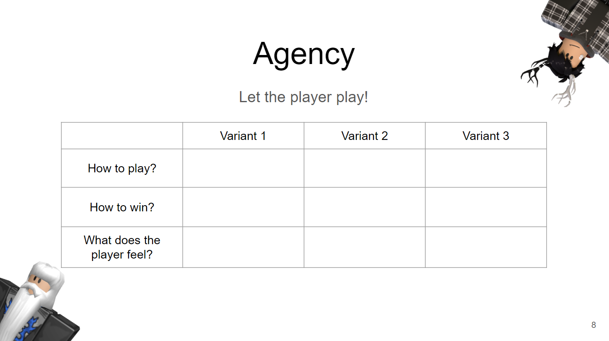{: loading="lazy"}
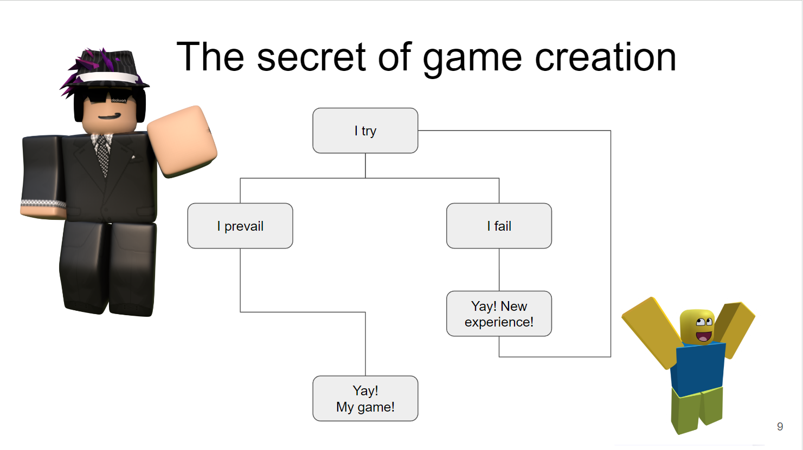{: loading="lazy"}
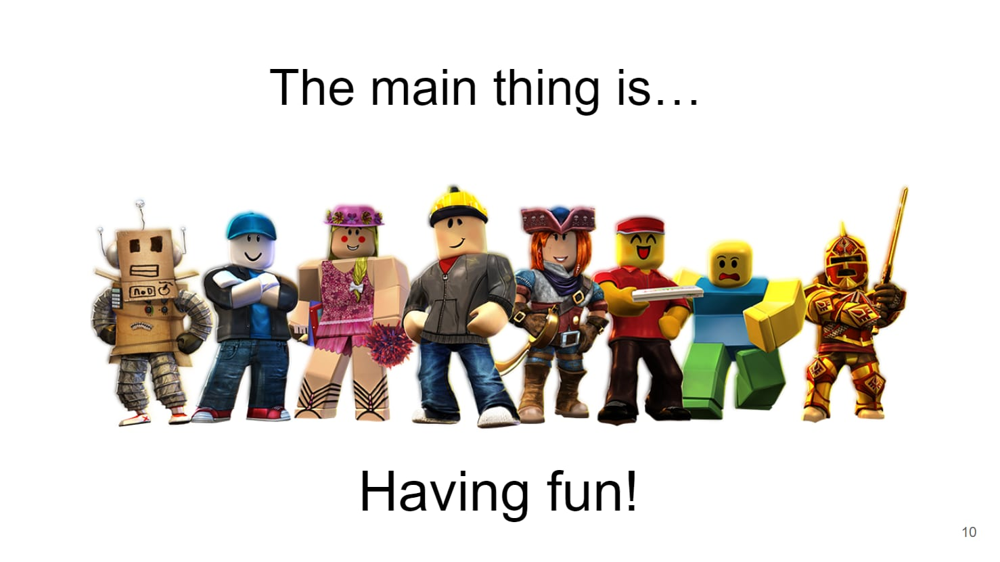{: loading="lazy"}

Here are the slides for one of the next lessons with the introduction of the game mechanics topic:
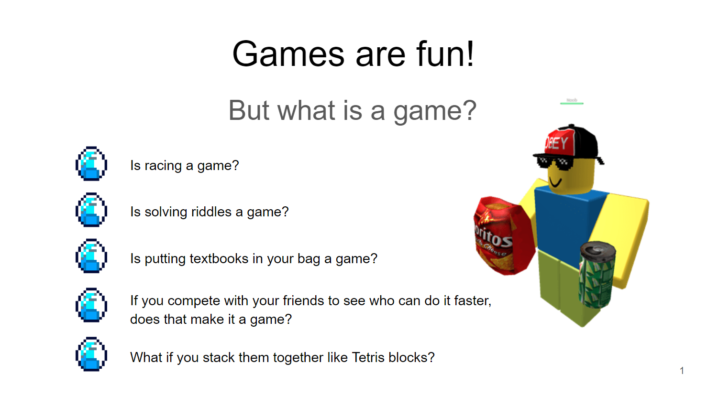{: loading="lazy"}
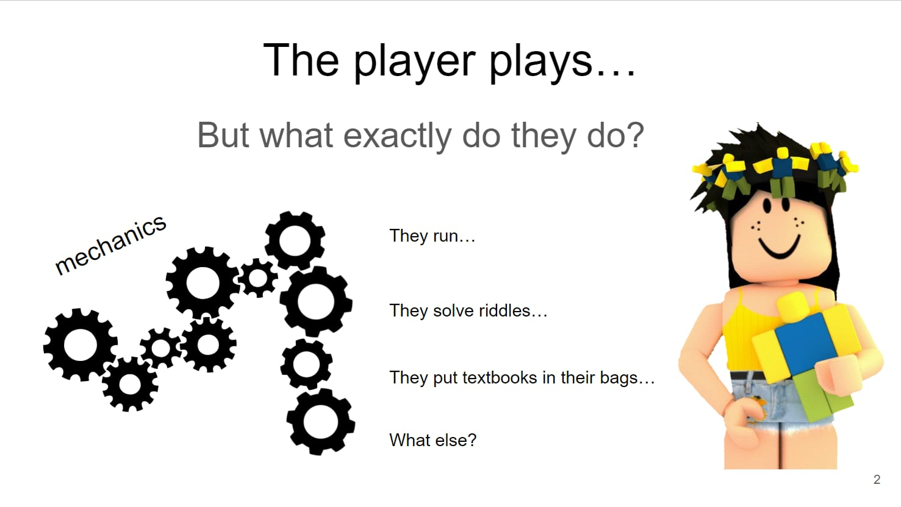{: loading="lazy"}
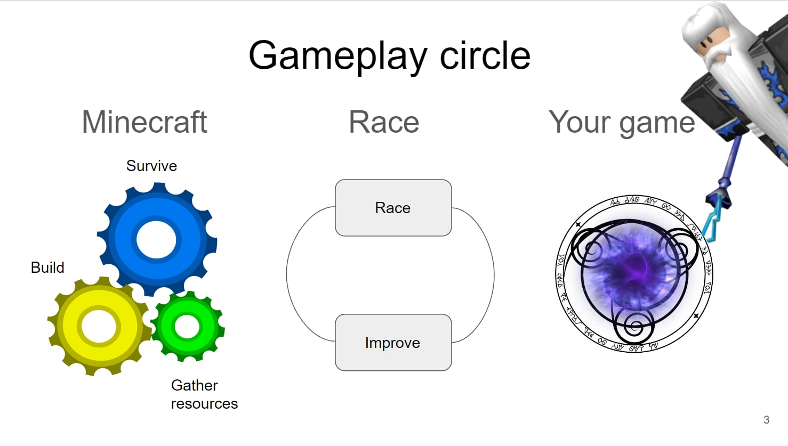{: loading="lazy"}
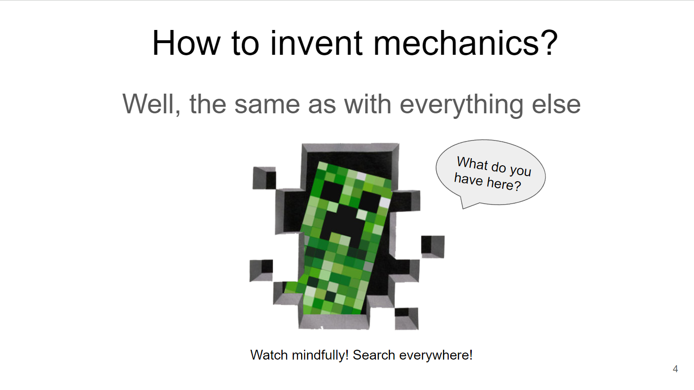{: loading="lazy"}
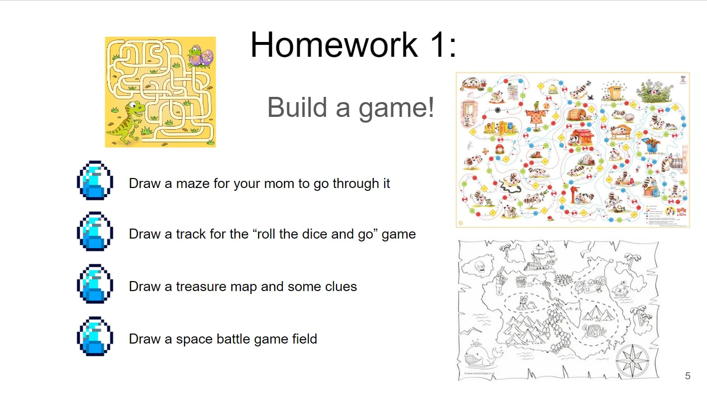{: loading="lazy"}
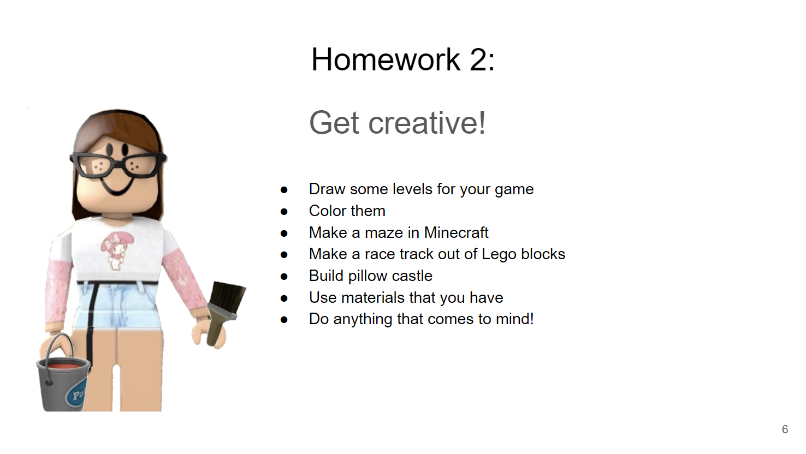{: loading="lazy"}
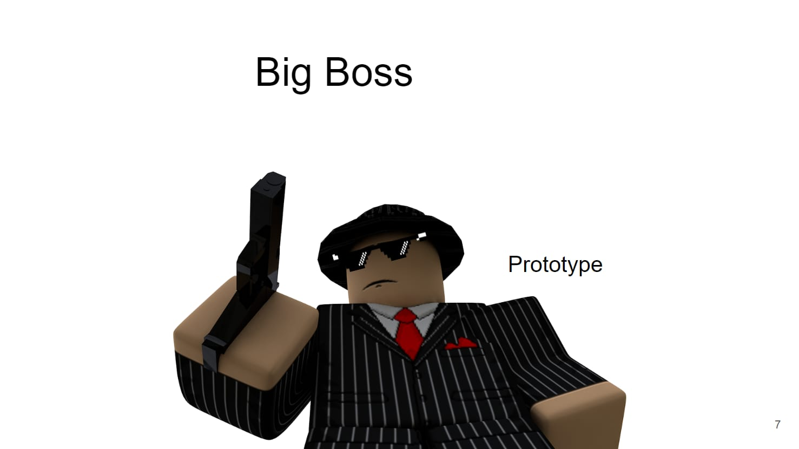{: loading="lazy"}

_All images used in slides are copied from open sources and used only for learning purposes, all copyrights for the images belong to their respective authors._
