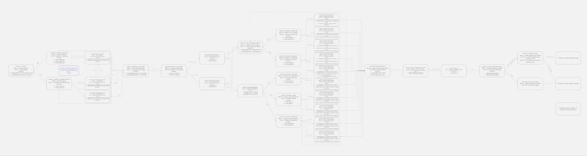

[Sparkle Inside](https://taisiia.itch.io/sparkle-inside){:target="_blank"} is a hackathon project that was created in just two days by a team of non-professionals. As the producer and screenwriter of the project, I had the privilege of managing a diverse team of seven individuals from five different time zones, which was an incredible challenge in itself.

Despite the limitations, I am proud of what we accomplished, and I believe it serves as a testament to the power of hard work and dedication.

While the final result may not have been perfect, it was an invaluable experience that taught me a great deal about project management, collaboration, rigid prioritization and creative problem-solving. I am excited to share it with you here.



An ethereal creature wakes up locked inside a ruined house that she cannot even remember. She must journey through several rooms all the way up to the attic, seeking out and examining old memories. She is forced to confront the same rejection and harsh choices from the memories again. She must find the strength to relive those moments and overcome them.

As she collects the memories, she realizes that she is a Sparkle - someone's creative force, long forgotten and locked away inside them. She must decide whether to accept her fate, the choice of the person who locked her away to alleviate their pain, or try to break free despite everything, finding her only way out - the way through.

Here is the dialogue structure for the project.

{: loading="lazy"}
