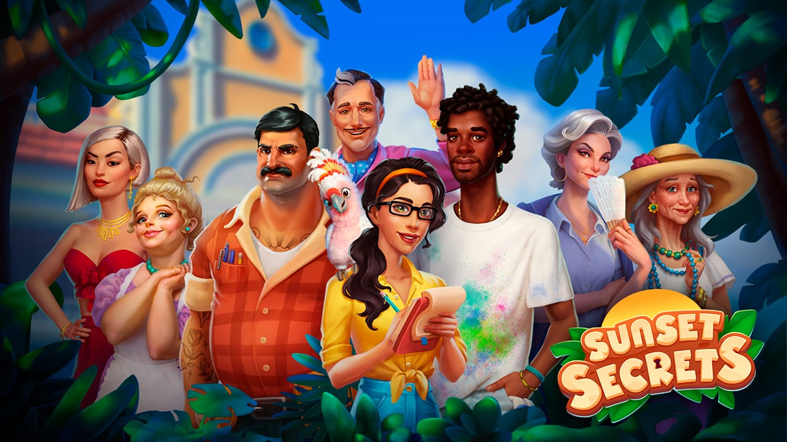

[Sunset Secrets](https://play.google.com/store/apps/details?id=com.PuzzlePoint.SunsetSecrets){:target="_blank"} is a mobile story-based match-3 game in the detective genre in a modern setting for the preferred audience of women 35+ choosing emotionally enriching and light mood narratives.

_All images are used for learning purposes from open sources, all copyrights for the images belong to their respective authors._

## Gameplay



## What I did

For this project I:

- Produced an intriguing nonlinear detective story with several plot twists based on crossing character arcs, providing a complex and engaging narrative that keeps players invested in the game.
- Created over 10 unique characters, each with a distinct personality, collaborating closely with the art and animation team to ensure their appearance was in sync with the narrative flow and character traits.
- Designed several mechanics and puzzles, providing a variety of challenges, and adding variety to the gameplay, thus making the game more interesting.
- Crafted a series of romantic and humorous scenes in a dynamic diamond-shaped format, offering players an entertaining way to advance through the story.
- Collaborated closely with the game design team to develop a narrative integrated with core mechanics and match-3 pieces, providing context and meaning for the gameplay.
- Formulated challengingly concise dialogues containing less than 140 characters per line and no more than 7 lines, providing essential information without interrupting the gameplay flow.
- Delivered dialogues with various UX solutions enhancing players’ immersion, providing more dynamic and interactive gameplay and inclusive, accessible experience.
- Crafted game trailer script with the dual purpose of highlighting the game's features and producing excitement in the audience while providing backstory and context to set the tone and build anticipation.
