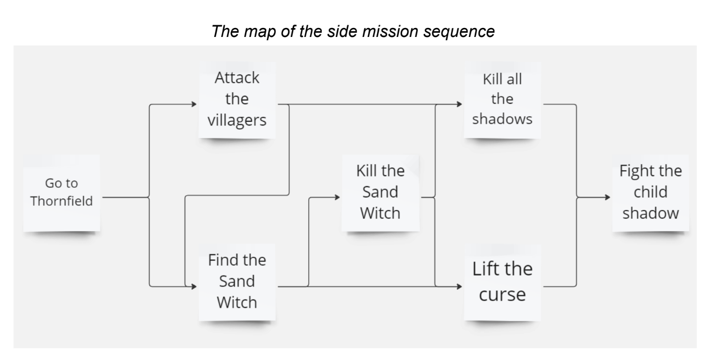

[Diablo 4 style branching side mission sequence](https://drive.google.com/file/d/1NocLjJsZpqCCPLm0WeDFNzytpBaBDbFm/view?usp=sharing){:target="_blank"} shows how I craft a branching narrative for slasher or RPG-type games. My goal was to enrich the game world and create a lasting impact on players. This mission sequence emphasizes combat and exploration gameplay within a haunting and eerie atmosphere, and offers players multiple choices, moral dilemmas, and encounters, contributing to the dark fantasy setting.

{: loading="lazy"}

The tale begins at Nightfall Citadel, where the main hero stumbles upon a tragedy – a dying woman's plea to save her child, taken to the cursed village of Thornfield. Venturing into Thornfield reveals a gruesome secret: a curse forces the villagers into a horrific choice – sacrifice a child each year or transform into monstrous entities. But is it really the curse forcing them?

## Excerpt {#excerpt}

**Trigger:** The main hero arrives at the Nightfall Citadel and finds a man and a woman on the ground inside one of the houses. The man is dead. The woman with her last breath asks the main hero to save their newborn child Nemo who has been taken back to their village Thornfield that they had fled from trying to save themselves behind city walls. She dies before she can add anything else.

**Thornfield village**

Description: Once the main hero is close enough to Thornfield, they find trails of blood along the path that lead them straight to the ambar on the back of the village. Inside the ambar they find a hidden sacrificial circle with the dead child in it.

People of Thornfield beg the main hero to spare them. They reveal that the curse will turn them into monsters unless they all stay at the village and sacrifice one child a year. That’s why they can not leave to find a cure and that’s why Nemo had to be sacrificed and his parents had to be killed before the curse devoured the whole village.

They claim the cause of the curse is the Sand Witch. One night she ran into Thornfield crying that her caravan from Dunekeep was crushed by some shadows and begging for somebody to help her child who had been taken by them. The villagers did not believe her. The whole story was too suspicious. She screamed and cursed them all to be doomed to stay here forever and kill their children so they would know what she felt, or they themselves would turn into monsters. The dirt and sand flew around her, she pointed her finger at the elder and he turned into a horrible aberration.

The villagers ask the main hero to find and kill that woman. They just want to live their lives.

The player may choose to:

- Try to find the Sand Witch in the city of Dunekeep in desert lands to lift the curse (1)
- Slaughter villagers since they have already become the monsters they were trying to avoid being turned into (2)

[Read the full branching mission sequence (PDF)](https://drive.google.com/file/d/1NocLjJsZpqCCPLm0WeDFNzytpBaBDbFm/view?usp=sharing){:target="_blank"}
